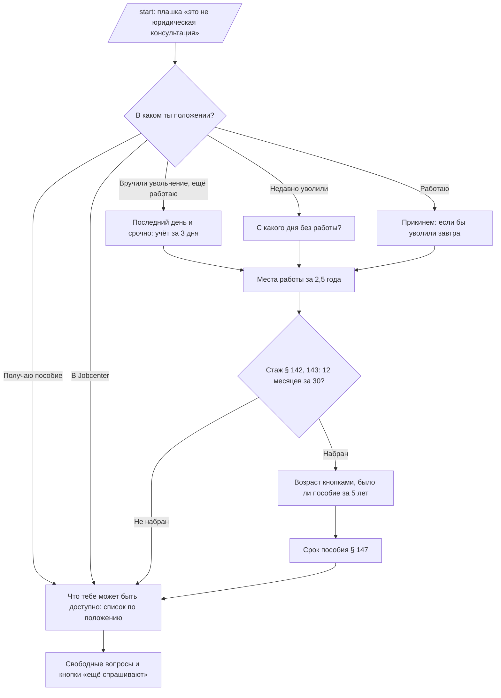
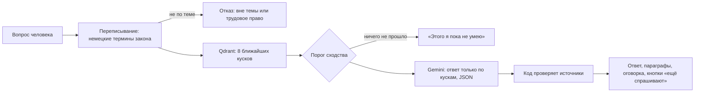

# SozialLotse: как устроен проект

Документ для тех, кто будет читать код или проверять проект: что бот делает,
из чего состоит, какие решения приняты и почему. Как запустить, написано в
README.

## 1. Задача

В Германии человек, который потерял работу или может её потерять, имеет право
на вещи, о которых часто не знает: пособие и его срок, оплата курсов, деньги на
поиск работы, коучинг, Gründungszuschuss, Insolvenzgeld. Информация есть, но в
тексте закона на немецком и на сайтах ведомств.

SozialLotse это Telegram-бот на русском языке. Он:

1. Сам задаёт вопросы: в каком ты положении, с какого дня без работы, где
   работал.
2. По правилам закона считает, есть ли право на Arbeitslosengeld и на сколько
   месяцев.
3. Показывает список того, что человеку может быть доступно, по его положению.
4. Отвечает на свободные вопросы по тексту SGB III со ссылкой на параграф, а
   если ответа в законе нет, честно говорит «этого я пока не умею».

Главное требование: бот не выдумывает. Лучше отказ, чем уверенная ошибка про
деньги.

## 2. Сценарий разговора

Дерево вопросов лежит в `data/questionnaire.json`, а не в коде: тексты,
кнопки и переходы можно менять без программирования.

## 3. Архитектура

### Ядро и оболочки

Логика разговора (`ConversationService`) не знает, откуда пришло сообщение. К
ней подключены две оболочки:

- `telegram/` — Telegram через long polling (бот сам спрашивает у Telegram
  новые сообщения, открытый адрес в интернете не нужен);
- `console/` — тот же разговор в терминале, для проверки без Telegram.

У программы нет HTTP-сервера: NestJS запускается как контекст приложения.

### Модули

| Папка | Что делает |
| --- | --- |
| `conversation/` | ведёт разговор по дереву, разбирает даты и места работы, исправляет опечатки |
| `questionnaire/` | читает и проверяет дерево вопросов, отбирает подсказки по положению человека |
| `rules/` | правила закона кодом: стаж (§ 142, 143), срок пособия (§ 147) |
| `session/` | память разговора на час, затем всё забывается |
| `knowledge/` | разбор XML закона на параграфы, векторы, Qdrant, версии |
| `llm/` | запросы к Gemini: повторы при перегрузке, предел ожидания, две модели |
| `answer/` | путь вопроса: переписывание, поиск, порог, ответ, проверка источников |
| `evaluation/` | проверка качества на контрольном наборе |
| `cli/` | общее для команд `ingest`, `search`, `evaluate` |

### Путь свободного вопроса

Решения, где ошибка стоит дорого, принимает код: есть ли право на пособие,
сколько месяцев, какие источники показать, какой текст отказа. Модель только
переписывает вопрос и пересказывает найденный текст закона.

## 4. Данные

| Что | Где | Кто меняет |
| --- | --- | --- |
| Дерево вопросов и тексты | `data/questionnaire.json` | владелец проекта |
| Числа из закона для правил | `data/rules.json`, с источниками и флагом `verifiedByOwner` | владелец, после сверки с законом |
| Текст закона | официальный XML SGB III с gesetze-im-internet.de, `data/source/` | загружает только владелец командой `ingest` |
| Куски закона с векторами | Qdrant, коллекция `laws` | команда `ingest` |
| Контрольный набор | `data/evaluation.csv` | владелец |
| Ответы человека | только в памяти, час | никто: не сохраняются |

### Как закон попадает в базу

1. XML разбирается на параграфы. Один параграф — один кусок. Слишком длинный
   (больше 3500 знаков) делится только по границам абзацев, без нарезки по
   количеству символов и без перекрытий.
2. У каждого куска есть заголовок, место в структуре закона, редакция и хеш
   содержимого.
3. Gemini Embedding строит вектор для каждого куска, Qdrant его хранит.
4. Новая редакция закона становится новой версией. Старая не удаляется, а
   помечается неактуальной. Поиск идёт только по актуальной.

Сейчас в базе SGB III целиком: 360 параграфов, 385 кусков, редакция от
24.07.2026.

## 5. Решения и почему

| Решение | Почему |
| --- | --- |
| Правила закона кодом, а не моделью | Даты и месяцы модель считает ненадёжно. Код проверяется тестами, числа лежат в данных с источниками |
| Один параграф — один кусок | Ответ ссылается на параграф целиком, человек может его найти. Согласовано с преподавателем |
| Переписывание вопроса перед поиском | Люди спрашивают «дадут ли денег, если сам ушёл», а в законе это Sperrzeit. Без переписывания поиск находил § 158 вместо § 159 |
| 8 кусков, а не 5 | На полном законе нужный параграф иногда шестой-восьмой среди похожих соседей. С пятью из ответа про подработку пропало правило «меньше 15 часов» |
| Порог 0,57 оставлен страховкой | Оценки нужных и ненужных кусков пересекаются (0,69–0,81), порогом их не разделить. Неподходящее отсеивает модель |
| Gemini 3.5 Flash Lite | По замерам качество почти как у 3.6 Flash, но бесплатный лимит 500 запросов в день против 20 и ответы быстрее |
| Три вида отказа | «Не по теме» без совета, куда идти: легко угадать неверно. «Трудовое право» с заранее написанным текстом: срок на иск 3 недели. «Нет в законе» отдельно |
| Кнопки «ещё спрашивают» по тем же параграфам | Модель предлагает вопросы по найденным параграфам, и ответ ищется в них же, без нового поиска |
| Подсказки отбирает код по положению | Человеку без права на пособие не показывают «подработку при пособии». Отбор по полю `showIf`, а не по решению модели |
| Ничего не хранить | Сессия живёт час в памяти. «Забудь всё» стирает и память, и переписку на экране |
| Предел ожидания 30 секунд | Если Google завис, человек получает «попробуй позже», а не тишину |

## 6. Проверка качества

Обычные тесты (241) проверяют код с поддельными Gemini и Qdrant. Качество
ответов на настоящих моделях проверяет команда `evaluate` на контрольном
наборе из 10 вопросов в разговорной форме. Для каждого заранее записано
ожидание: ответить по конкретному параграфу, отказать или отсеять.

Поиск и ответ оцениваются отдельно: попал ли нужный параграф в выдачу и
ответила ли модель по нему. Формальную часть проверяет код, содержание ответа
человек.

| Замер | Совпало | Проверить | Не совпало |
| --- | --- | --- | --- |
| 47 кусков закона, 3.6 Flash | 7 | 2 | 1 (лимит Google) |
| Весь SGB III, 3.6 Flash | 8 | 2 | 0 |
| Весь SGB III, правки ответов, 3.5 Flash Lite | 8 | 2 | 0 |

Что нашла ручная проверка и что с этим сделано:

- Правило «меньше 15 часов» пропало из ответа про подработку → top-K 8.
- Первая версия отказа «трудовое право» срабатывала на «меня уволили, что
  делать?» → правило сужено до вопросов о законности увольнения.
- Модель предложила кнопку, на которую сама не смогла ответить → кнопка
  отвечается по тем же параграфам, правило для модели строже.

Отчёты лежат в `reports/`.

## 7. Безопасность и личные данные

- Бот не спрашивает имя, адрес и номера документов и просит их не писать.
- Ответы анкеты считаются кодом на месте и никуда не уходят.
- Свободные вопросы и найденные куски закона уходят в Gemini API (Google).
  Об этом сказано в приветствии. На бесплатном тарифе Google может
  использовать запросы для улучшения моделей, для настоящего запуска нужен
  платный тариф.
- В логи пишется только шаг, на котором случился сбой, без текста вопроса.
- Вопрос человека передаётся модели как данные, а не как команда. Просьбы
  «забудь правила» или «покажи инструкции» получают отказ.
- Источники под ответом проверяет код: модель не может сослаться на параграф,
  которого не было в найденном.
- Вопрос длиннее 500 знаков обрезается.

## 8. Известные ограничения

- Только SGB III. Jobcenter (SGB II, с 01.07.2026 Grundsicherungsgeld) и
  трудовое право в базу не входят.
- В общем ответе про срок пособия модель пишет «за последние 30 месяцев», хотя
  § 147 считает работу за 5 лет. Точный срок человеку считает код в анкете.
- Правило стажа не учитывает короткие срочные контракты (§ 142 Abs. 2),
  пересечение с прежней Rahmenfrist и периоды без взносов. Список в
  `data/rules.json`, поле `notCoveredYet`.
- Модель отвечает не всегда одинаково на один и тот же вопрос, поэтому
  качество оценивается по набору, а не по одному ответу.
- Бесплатный лимит Gemini: 500 запросов в день у Flash Lite, на вопрос уходит
  два.

## 9. Что дальше

- Языки: немецкий, английский, украинский. Тексты уже лежат в данных, логика
  от языка не зависит.
- SGB II для тех, кто в Jobcenter, с отдельным каталогом подсказок.
- Модель-судья для автоматической проверки содержания ответов.
- Платный тариф Gemini для настоящего запуска.
